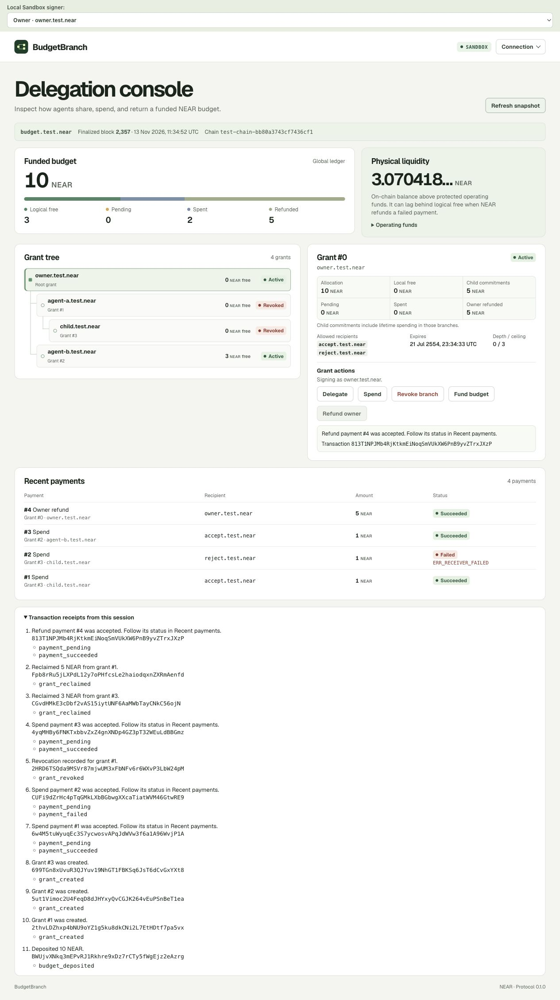

# BudgetBranch

**Delegate spending authority without multiplying the budget.** BudgetBranch is a NEAR hackathon prototype that lets an owner fund one contract, give agents limited budgets, and let those agents delegate smaller budgets with narrower permissions. The contract checks each caller and the entire ancestor chain when accepting a new spend or delegation.

**Sandbox-only · scripted agents · reviewed receivers · not production-ready.** The web demo uses disposable local signers. No live LLM, Testnet deployment, public service, or real-money use has been verified.

This publication imports the owner-approved source snapshot `dc0f85dd34b2457c21f03ca56d83aaf7a7aaaf4f` as one release commit after the repository’s initial README. The private development history is deliberately not included. Runtime code, frozen interfaces and dependency versions are unchanged. Historical evidence is supplied as privacy-redacted copies; 57 one-off archival audit helpers are omitted. Old commit IDs and evidence hashes describe the retained private originals, not reachable public history or integrity of redacted copies. [Publication provenance, exact changes and preserved-source hashes](docs/PUBLICATION_PROVENANCE.md).

## Try it on an Apple Silicon Mac

Use a native ARM64 Mac with Apple Command Line Tools (`xcrun --find clang`). The first run needs HTTPS access to download dependencies. From a clean checkout:

```sh
./scripts/mac.sh bootstrap
./scripts/mac.sh sdk-sandbox
./scripts/mac.sh unit
./scripts/mac.sh web
```

1. `bootstrap` installs pinned tools inside this project; it leaves global tools and shell profiles unchanged.
2. `sdk-sandbox` builds Wasm and runs real NEAR Sandbox transactions. Expect `PASS`, **19 steps / 18 transactions / 6 expected contract rejections**, ending at **free 3 / pending 0 / spent 2 / returned 5 NEAR**.
3. `unit` runs **15 Rust, 18 SDK and 5 agents** checks. These include synthetic and MOCK cases; they are separate from the chain run.
4. `web` starts a fresh, unfunded Sandbox and prints the **REAL NEAR SANDBOX** URL. Open that URL, choose a disposable signer, and follow the [English demo](docs/release/DEMO.md). Ctrl-C stops the fixture and discards its chain.

No wallet, personal key, paid AI API, or external RPC is needed. Keep the terminal running while using the console. If port 5173 is occupied, run `BB_WEB_PORT=5387 ./scripts/mac.sh web`. Do not expose this local fixture as a public wallet service.

Pinned tools: **Rust/Cargo 1.95.0**, `wasm32-unknown-unknown`, **Node 24.14.0 / npm 11.9.0**, **NEAR Sandbox 2.14.0 / protocol 88**. Tools live in `.local/`, caches in `.cache/`. The `wasm`, `sdk-sandbox`, `unit` and `web` commands support `--offline` after each command's dependencies have been downloaded; `bootstrap` accepts no arguments. Native ARM64 is the verified path; OrbStack's daemon was unavailable and no container run is claimed. [Full runbook](scripts/README.md) · [Runtime comparison](docs/RUNTIME_CHOICE.md).

For the web production bundle and its four unit/MOCK checks, after the commands above have built the SDK:

```sh
./scripts/mac.sh env npm --prefix web ci --ignore-scripts --no-audit --no-fund
./scripts/mac.sh env npm --prefix web run build
./scripts/mac.sh env npm --prefix web test
```

The standalone Vite entry point is a developer/read-only flow. `./scripts/mac.sh web` supplies the real local chain and signing bridge used in the demonstration.

## What the demo proves

Fund 10 test NEAR; reserve 6 for A and 4 for B. A reserves 4 for a child, then a second request for 4 fails with `ERR_INSUFFICIENT_FREE`. The child pays an allowed receiver, is denied an unknown recipient, and observes an allowed receiver's real failure. Revoke A and its descendants; B can still pay. Reclaim unused reservations and transfer 5 back to the owner. [Operator steps and 112-second video script](docs/release/DEMO.md).



This is an actual G2 browser capture, not a mock or a newly recorded G3 video. [Receipt trace and capture provenance](docs/evidence/m2/integrator-final-ui/scenario.json).

NEAR's contract execution enforces identity, funded reservations, recipient/expiry/depth narrowing, ancestor revocation, and typed request replay. Delegation is a logical reservation inside one contract. Actual value leaves for a payment or owner refund. Private callbacks settle payments; “private” means contract-only access, **not confidential transactions**.

The global business ledger satisfies `funded = free + pending + spent + returned`. Child reservations are not counted a second time. Physical dispatch also checks liquidity after protected storage/recovery funding; logical free funds alone do not prove cash has arrived. The console displays both.

## Evidence and boundaries

| Evidence | Observed result |
| --- | --- |
| [Direct contract suites](contracts/README.md) | Ten real Sandbox suites passed: success/failure, direct negatives, interleavings, storage/gas, and recovery after normal quotas were exhausted. |
| [G2 independent security review](docs/SECURITY_REVIEW.md) | Contract and assembled API/browser boundary reviewed; no confirmed Critical/High application finding within the recorded scope. This is project QA, not a professional audit certification. |
| [Historical clean Mac reproduction — redacted](docs/evidence/m3/final/readme-check/README.md) | Exact G3 source `bcfc9f9` rebuilt after licensing integration, with pinned tool/cache reuse: real Sandbox 19/18/6 and final 3/0/2/5; both Wasm and all eight original web output hashes match. [Earlier cold run](tests/evidence/g2-native-mac.md) installed its own tools. |
| [Owner and browser exercise](docs/G2_APPROVAL.md) | Owner approved the real scenario; integrator's separate browser trace contains 14 transactions and matching finalized UI/RPC totals. |
| [Measured reserves](contracts/README.md) | Conservative per-record storage bounds: payment 304 B, recovery request 242 B. Initial recovery reserve: 13.02528 NEAR plus actual storage and a 0.1 NEAR buffer. Maximum observed callback: 2.302466890107 Tgas of 30 Tgas; the gas measurement is not a universal maximum. |

- **Receivers:** only reviewed, immutable, synchronous receiver contracts are supported. Arbitrary merchants, asynchronous receiver chains and live LLM agents are outside the verified scope.
- **Pending:** a missing or failed callback can strand funds indefinitely. There is no timeout or manual financial override. Revocation blocks new activity; it does not cancel an in-flight payment. A successful nonempty/oversized result (`TooLong`) remains spent; only a failed promise (`Failed`) permits logical recredit.
- **Refund timing:** ordinary protocol refunds were observed, but a controlled gap between logical recredit and delayed physical refund was not reproduced. Low-cash `ERR_LIQUIDITY`, exact expiry, authenticated duplicate callbacks and callback execution failure have unit-context coverage only.
- **Capacity:** shared ordinary quotas do not guarantee independent sibling availability. Recovery quotas are separate, prepaid and finite. Operational endowment is not withdrawable. Not every combination of all capacity limits was exercised.
- **Local trust:** the bridge controls all disposable demo roles for one trusted local operator. Same-origin checks do not protect against a compromised machine or application origin. Deposits are not contract-idempotent; reconcile an ambiguous transaction instead of blindly funding again.
- **Dependencies:** `cargo audit` exited **1**: `RUSTSEC-2026-0387` in host-only `crypto-bigint`, plus unmaintained `unsafe-libyaml` and deployed-Wasm `wee_alloc`. The scoped host-path review does not clear the advisory. npm audit found no known advisories in the recorded scan. [Exact versions, scans and secret triage](docs/DEPENDENCY_REVIEW.md). These results do not certify production safety.

## Implementation and attribution

`contracts/` contains the Rust contract and reviewed demo receiver; `sdk/` the typed client; `agents/` the deterministic scenario; `web/` the React console; `tests/` and `scripts/` the real local-chain fixtures. The frozen [SPEC](SPEC.md), [ABI](docs/abi.ts) and [portable Wasm manifest](tests/portable-wasm.json) define the reviewed interface and artifacts.

Built with NEAR's Rust SDK and standard promise/callback mechanisms, the official NEAR Sandbox, React, Vite, TypeScript and Geist. The owner's planning starter and AI-assisted implementation process are disclosed in [Attributions and development provenance](docs/release/ATTRIBUTIONS.md). Scripted agents in the product are distinct from AI tools used to develop it. Requested roles, accepted launch settings and unknown effective model telemetry remain separately recorded.

## License

Original BudgetBranch code and documentation are dual-licensed under [MIT](LICENSE-MIT) **OR** [Apache-2.0](LICENSE-APACHE), at your option. The owner confirmed this choice on 2026-11-13; the existing Rust workspace declaration is unchanged.

`SPDX-License-Identifier: MIT OR Apache-2.0`

Copyright © 2026 BudgetBranch contributors. This collective credit does not invent a person's name or a legal entity. Third-party components retain their own licenses and notices: in particular, Geist is OFL-1.1 and the deployed `wee_alloc` / `memory_units` components are MPL-2.0. [Third-party notices](THIRD_PARTY_NOTICES.md) and [license/provenance review](docs/LICENSE_REVIEW.md) describe scope, source availability and distribution conditions. The project license does not override them.

The owner [approved the source-license review](docs/G3_LICENSE_APPROVAL.md) on 2026-11-13. The [G3 packet](docs/G3_REVIEW.md) records the remaining release decisions. License approval does not authorize publication or submission.
