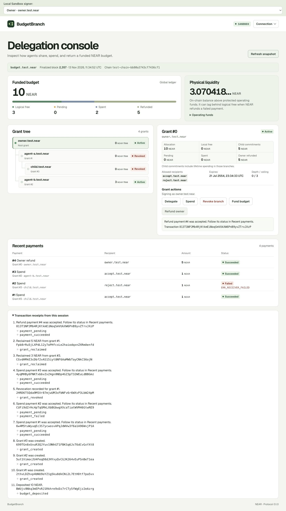

> **Publication-copy notice:** This document records the private development review. Historical logs and reports may be redacted, and one-off audit helpers are omitted. Any original/byte-identical claims and historical hashes below refer to the private artifacts before publication processing, not necessarily these public copies. See [publication provenance](PUBLICATION_PROVENANCE.md) for scope, exclusions and current file hashes. Use the root README for runnable commands.

# BudgetBranch — пакет проверки G2

**Приложение готово к проверке владельцем. G1 утверждён; G2 ожидает отдельного решения.** Контракт, SDK, scripted agents, локальный bridge и веб-интерфейс работают вместе на реальном NEAR Sandbox. Финансовая архитектура G0 и утверждённое ядро G1 не изменены.

## Точная версия

Проверенный code commit в `integration`: **`1ea24af7c97db1733d920a2949d681218d24687f`**. Следующий metadata commit добавляет этот пакет и доказательства; исполняемый код сохраняется. [Manifest исходников и проверки freeze](evidence/m2/integration-manifest.json).

- G1 утверждён владельцем на `4564d46d8019789146226fc4cd4b5e5aa25fcb80`; [решение и версии документов](G1_APPROVAL.md).
- G2 baseline: `826803d658bf3bddd8f2d7ef03869c2da8e7d4f7`.
- Frontend correction: source `7a5401a0cf285b435bf4e4b910d7748552dbe6f4` → `a30df84`. Root остаётся выбранным при появлении первого ребёнка, сохраняются квитанция и последующий черновик формы.
- Startup correction: source `277a0efd620dfdca076e4613f5279162f6d53cd8` → `1ea24af`. Явные ошибки неверного/занятого порта и запрета loopback; cleanup защищён `finally`.
- Contracts tree: `2c691ebdbd23e9d9e22ea67fc3aa22c9b5226106`, без изменений G2. SPEC, ABI, ошибки, события и frozen worker interfaces совпадают с [G0 manifest](FROZEN_INTERFACE.json).
- BudgetBranch Wasm SHA-256: `2c862acc53ae8cd02f6dbf8430c1271ebbf16de27df2e2d5a77c7a52efc5aa23`.
- Receiver Wasm SHA-256: `40bc851605e5084acdb29d163e0b4c4df50dbd62189da63383e16847171f3655`.

Правки проверены по фактическим diff и приняты только в `integration`. Независимый QA не писал реализацию. Роли Astra/Max и Sol 6.1/Max сохранены; фактические model/effort интегратора **UNKNOWN/UNKNOWN**, telemetry исполнителей также не подтверждается настройками запуска. [Журнал делегирования](evidence/m2/integration-manifest.json).

## Запуск и демонстрация

На Apple Silicon из корня checkout:

```sh
./scripts/mac.sh bootstrap
./scripts/mac.sh sdk-sandbox
./scripts/mac.sh unit
./scripts/mac.sh web
```

Откройте URL из последней команды. [Пошаговая демонстрация на русском](G2_DEMO_RU.md), [полный runbook и диагностика](../scripts/README.md). Первая загрузка требует HTTPS и Apple Command Line Tools. Локальные Node24.14.0/npm11.9.0, Rust1.95.0/Wasm target и NEAR Sandbox2.14.0 не меняют глобальное окружение. После прогрева доступны команды с `--offline`. Ни кошелёк, ни платный AI API не нужны.

Нативный ARM64 Sandbox — фактически проверенный путь. OrbStack установлен, но при проверке daemon не работал, `docker info` завершился1. Контейнерная сборка и Dockerfile не заявлены как работающие. [Сравнение вариантов](RUNTIME_CHOICE.md).

## Выполненные проверки

| Проверка | Результат и доказательства |
| --- | --- |
| Чистый Mac checkout | Integration worker стартовал на baseline826803d без `.local`, `.cache` и `BB_TOOLCHAIN_ROOT`. Bootstrap, locked Wasm, real SDK,15 Rust/18 SDK/5 agents unit/MOCK, web4/build завершились0. Совпали portable Wasm. [Отчёт](../tests/evidence/g2-native-mac.md), [сырые команды/логи](evidence/m2/clean-mac/manifest.json). |
| Путь с пробелами | Свежий archive `BudgetBranch with spaces` собрал Wasm и прошёл реальный SDK-сценарий и web build; использовал toolchain, только что загруженный этим cold run. Это проверка пути исходников/сборки, не второй cold bootstrap. |
| Собранный точный commit | Интегратор на чистом checkout1ea24af повторил реальный SDK: **19 шагов,18 транзакций,6 прямых отказов**, exit0. Web4 unit/MOCK и production build —0. Неверные порты и реальный занятый порт дают ожидаемый exit1, существующий listener остаётся доступен. [Команды и результаты](evidence/m2/integrator-combined/run.json). |
| Полный браузерный сценарий | На1ea24af интегратор выполнил **14 реальных транзакций** через формы, включая3 initiating rejects, сужение allowlist/expiry/depth, вложенное делегирование, успешный/неудачный receiver, revoke и refund_owner. **Итог3 free /0 pending /2 spent /5 returned NEAR**. [Сценарий/хеши](evidence/m2/integrator-final-ui/scenario.json), [наблюдения UI](evidence/m2/integrator-final-ui/ui-observations.json), [прямой финализированный RPC snapshot](evidence/m2/integrator-final-ui/final-snapshot.json). |
| Точность денег | Отдельно проверены локальные allocation equations, parent child_reserved и глобальные суммы без двойного учёта. UI показал реальные Pending для платежей2,3 и refund4, затем terminal statuses. Прямой RPC подтвердил B allowlist/depth/expiry, inherited revoke и итог. |
| Независимый Security QA | Whole-system baseline audit плюс отдельная проверка обеих правок на точном1ea24af: API, browser trust boundary, signer, replay/concurrency, ошибки доставки, точность1yocto, startup/cleanup. [Независимый отчёт и границы](SECURITY_REVIEW.md). |
| Зависимости и секреты | npm audit:0 известных advisories. **cargo audit: exit1, один advisory и два maintenance warnings остаются открытыми**. Gitleaks history:0 находок; финальный source scan:exit1,5 совпадений — все проверены как SHA-256 публичных QA-файлов, подтверждённых секретов0. [Результаты и оценка риска](DEPENDENCY_REVIEW.md). |
| Автономный агент | Возможность отдельной Codex-assisted демонстрации оценена без изменения контракта. Локальный inference runtime не обнаружен ограниченной проверкой. **LIVE AI не реализован и не продемонстрирован**; приложение честно использует scripted agents. [Оценка](DEPENDENCY_REVIEW.md#optional-genuine-agent-demonstration). |

Cold bootstrap относится к826803d; итоговые SDK/UI и независимая проверка delta относятся к1ea24af. Это разные фактически выполненные прогоны. Все использовали одни неизменённые portable contract artifacts. Unit/MOCK и моделированные транспортные сбои не выдаются за реальное поведение сети.



## Остаточные риски

1. Контролируемое окно между логическим восстановлением free и поздним физическим refund не воспроизведено. `ERR_LIQUIDITY` сохранён; unit low-cash coverage и реальные обычные refund receipts не доказывают это окно.
2. Потерянный/упавший callback может оставить средства Pending навсегда. Ни timeout, ни ручной обход не освобождают резерв. Revoke не отменяет уже отправленный платёж.
3. Receivers только проверенные, синхронные и неизменяемые. Произвольные получатели не поддерживаются.
4. Operational endowment не выводится. Квоты конечны; обычные квоты общие для веток. Recovery имеет отдельные заранее оплаченные конечные квоты.
5. Открытый RustSec advisory касается host dependency; применимый путь утечки секретного целого QA не обнаружил. `wee_alloc` действительно входит в Wasm и остаётся неподдерживаемой зависимостью. **Это не чистый cargo audit и не production-ready безопасность.**
6. Bridge доверяет локальному оператору и позволяет ему переключать все disposable роли. Same-origin/session protections не являются изоляцией нескольких пользователей, защитой от вредоносного локального процесса, расширения браузера или компрометации собственного origin. Цепь временная.
7. Exact expiry, authenticated duplicate callback и failure/OOG callback остаются unit-context случаями. Измерения не покрывают одновременно каждую достижимую комбинацию максимумов.
8. Testnet, standalone live LLM runtime и hosted CI не проверены. Публичный репозиторий, видео/X-публикация и конкурсная заявка относятся к отдельному G3.

Измерения G1 сохраняются: payment304B, recovery request242B, начальный recovery reserve **13.02528NEAR** плюс фактический storage и0.1NEAR buffer; максимум измеренного callback **2.302466890107Tgas** при30Tgas prepaid. После исчерпания128grants/512spends/639достижимых normalrequests прошли callback, revoke,127reclaims и refund без нового operational funding. [Точные команды/артефакты G1](G1_REVIEW_RU.md).

## Решение владельца

Материалы готовы для самостоятельного запуска и нескольких действий владельца. Отдельное решение: **G2 APPROVED TO MERGE** либо **G2 CHANGES REQUIRED**. Контрольная точка G2 предусмотрена [OWNER_CHECKPOINTS_RU.md](../OWNER_CHECKPOINTS_RU.md) и текущим поручением владельца; успешные тесты не дают разрешения на main.

До такого решения нет merge в main. Push, GitHub/X publication, конкурсная отправка, Mainnet и реальные расходы также не разрешены. Для G3 потребуются отдельные решения о публикации и отправке.
